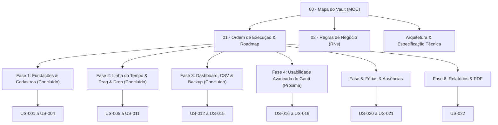

# 🗺️ Mapa do Vault (MOC) — Controle Mapa de Alocação

Bem-vindo à documentação oficial do produto **Controle Mapa de Alocação de Programadores** estruturada especialmente para navegação no **Obsidian**.

> [!NOTE]
> Este vault documenta a visão estratégica de produto, a matriz completa de regras de negócio, o catálogo de histórias de usuário (concluídas e planejadas) e a **ordem de execução (roadmap)** para implementação contínua.

---

## 📌 Navegação Rápida

---

## 📑 Índice de Documentos

### 1. Planejamento & Estratégia
- [[01 - Ordem de Execução & Roadmap|🚀 01 - Ordem de Execução & Roadmap]]: Cronograma ordenado por prioridade de impacto, esforço e fases de entrega.
- [[02 - Regras de Negocio (RNs)|⚖️ 02 - Matriz de Regras de Negócio (RNs)]]: RN-01 a RN-12 (regras de jornada, cores, cascata e integridade).
- [[Especificacao Tecnica|🛠️ Arquitetura & Especificação Técnica]]: Stack React 19 + Express 5 + SQLite nativo (`node:sqlite`).

---

### 2. Histórias de Produto (Concluídas — Baseline v1.0)
| Código | História | Epic / Módulo | Status |
| :--- | :--- | :--- | :---: |
| [[US-001 - Gestao de Programadores\|US-001]] | Cadastro e Gestão de Programadores | Cadastros Base | `✅ Concluído` |
| [[US-002 - Gestao de Projetos\|US-002]] | Cadastro e Gestão de Projetos | Cadastros Base | `✅ Concluído` |
| [[US-003 - Links e Pastas SharePoint\|US-003]] | Vínculo de Links e Pastas SharePoint/Git | Cadastros Base | `✅ Concluído` |
| [[US-004 - Paleta e Contraste Visual\|US-004]] | Paleta Dinâmica e Contraste de Cores | UX / Design | `✅ Concluído` |
| [[US-005 - Gantt Matricial\|US-005]] | Linha do Tempo Matricial (Gantt) | Alocação Visual | `✅ Concluído` |
| [[US-006 - Calendario Mensal\|US-006]] | Calendário Mensal Interativo | Alocação Visual | `✅ Concluído` |
| [[US-007 - Alocacao Integral e Parcial\|US-007]] | Alocação Integral (8h) e Dedicação Parcial | Alocação | `✅ Concluído` |
| [[US-008 - Drag and Drop de Alocacoes\|US-008]] | Drag & Drop de Alocações no Gantt e Calendário | Interatividade | `✅ Concluído` |
| [[US-009 - Alerta de Sobrecarga\|US-009]] | Detecção e Alerta Visual de Sobrecargas (> 8h) | Governança | `✅ Concluído` |
| [[US-010 - Drag to Fill (Alca de Preenchimento)\|US-010]] | Alça de Preenchimento Contínuo (Drag-to-Fill) | Produtividade | `✅ Concluído` |
| [[US-011 - Planejamento em Lote por Periodo\|US-011]] | Planejamento em Lote por Período e Dias Úteis | Produtividade | `✅ Concluído` |
| [[US-012 - Dashboard e Metricas\|US-012]] | Dashboard Executivo com KPIs e Gráficos | Gestão & BI | `✅ Concluído` |
| [[US-013 - Exportacao CSV Excel\|US-013]] | Exportação de Dados em CSV / Excel | Exportação | `✅ Concluído` |
| [[US-014 - Backup e Restauracao JSON\|US-014]] | Backup e Restauração Integral em JSON | Confiabilidade | `✅ Concluído` |
| [[US-015 - Temas Claro e Escuro\|US-015]] | Alternância de Modo Escuro e Modo Claro | UX / Design | `✅ Concluído` |
| [[US-023 - Gestao e Criacao de Usuarios e Gerentes de Produto\|US-023]] | Gestão e Criação de Usuários e Gerentes de Produto | Governança | `✅ Concluído` |

---

### 3. Histórias de Produto (Próximas — Backlog de Evolução v1.1 e v1.2)
| Código | História | Prioridade | Fase |
| :--- | :--- | :---: | :---: |
| [[US-016 - Accordion e Ocultar Linhas Vazias no Gantt\|US-016]] | Recolher/Expandir Projetos e Ocultar Linhas Vazias | `🔴 Alta` | **Fase 4** |
| [[US-017 - Ocultar Finais de Semana no Gantt\|US-017]] | Alternador para Ocultar Finais de Semana (Seg-Sex) | `🔴 Alta` | **Fase 4** |
| [[US-018 - Popover de Links SharePoint no Gantt\|US-018]] | Acesso Rápido aos Links do SharePoint no Gantt | `🔴 Alta` | **Fase 4** |
| [[US-019 - Edicao Flexivel de Alocacao no Modal\|US-019]] | Reatribuição Completa no Modal de Alocação | `🔴 Alta` | **Fase 4** |
| [[US-020 - Gestao de Ferias e Ausencias\|US-020]] | Bloqueio e Visual de Férias/Ausências da Equipe | `🟡 Média` | **Fase 5** |
| [[US-021 - Filtro por Status do Projeto\|US-021]] | Ocultar Projetos Concluídos ou Pausados | `🟡 Média` | **Fase 5** |
| [[US-022 - Exportacao PDF e Impressao\|US-022]] | Impressão e Exportação para PDF Executivo | `🟢 Média` | **Fase 6** |

---

> [!TIP]
> **Como usar no Obsidian:**
> - Você pode abrir a pasta `obsidian/` diretamente como um **Vault** no aplicativo Obsidian (`Open folder as vault`).
> - Todos os links utilizam a sintaxe de *wikilinks* `[[Nome da Nota]]` com suporte total a Graph View e busca por tags.
