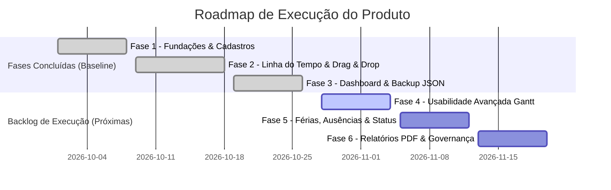

# 🚀 01 - Ordem de Execução & Roadmap de Produto

Este documento estabelece a **ordem oficial de execução** para o desenvolvimento e evolução do sistema **Controle Mapa de Alocação**.

> [!IMPORTANT]
> A priorização segue a matriz de **Impacto no Negócio vs. Esforço Técnico**, garantindo que as lacunas de usabilidade mais urgentes para o gestor sejam eliminadas nas primeiras iterações.

---

## 📊 Visão Geral das Fases



---

## 🎯 Sequência Detalhada de Execução

### 🟢 Fases Concluídas (Baseline v1.0)

#### Fase 1: Fundações & Cadastros Centrais
- [x] **[[US-001 - Gestao de Programadores|US-001]]**: Cadastro de programadores com nome obrigatório (RN-02), e-mail e tecnologias.
- [x] **[[US-002 - Gestao de Projetos|US-002]]**: Cadastro de projetos e escopo de atuação.
- [x] **[[US-003 - Links e Pastas SharePoint|US-003]]**: Associação de links dinâmicos aos projetos (SharePoint, Git).
- [x] **[[US-004 - Paleta e Contraste Visual|US-004]]**: Paleta de 12 cores exclusivas e algoritmo de contraste YIQ.

#### Fase 2: Visualizações Temporais & Interatividade
- [x] **[[US-005 - Gantt Matricial|US-005]]**: Linha do tempo matricial com projetos nas linhas e programadores nas sublinhas (RN-05).
- [x] **[[US-006 - Calendario Mensal|US-006]]**: Calendário de 35 a 42 dias com indicador de esforço diário.
- [x] **[[US-007 - Alocacao Integral e Parcial|US-007]]**: Alocação de 8h (dia todo) ou fracionada em horas específicas.
- [x] **[[US-008 - Drag and Drop de Alocacoes|US-008]]**: Movimentação por arraste entre datas e programadores.
- [x] **[[US-009 - Alerta de Sobrecarga|US-009]]**: Identificação e destaque visual de jornadas > 8h diárias.
- [x] **[[US-010 - Drag to Fill (Alca de Preenchimento)|US-010]]**: Alça de preenchimento contínuo para estender alocações rapidamente.
- [x] **[[US-011 - Planejamento em Lote por Periodo|US-011]]**: Planejamento multi-dias filtrando apenas dias úteis.

#### Fase 3: Inteligência, Portabilidade & Temas
- [x] **[[US-012 - Dashboard e Metricas|US-012]]**: Painel executivo com taxas de ocupação e esforço por projeto.
- [x] **[[US-013 - Exportacao CSV Excel|US-013]]**: Exportação de dados com codificação UTF-8 BOM para Excel.
- [x] **[[US-014 - Backup e Restauracao JSON|US-014]]**: Backup integral e restauração com validação estrutural.
- [x] **[[US-015 - Temas Claro e Escuro|US-015]]**: Suporte nativo a Light/Dark Mode com persistência local.

---

### 🟡 FASE 4: Usabilidade Avançada do Gantt & Atalhos (IMEDIATA)
> **Objetivo:** Tornar o uso diário do Gantt 3x mais rápido e compacto para equipes com mais de 5 projetos.

```
┌────────────────────────────────────────────────────────────────────────┐
│ ORDEM DE IMPLEMENTAÇÃO DA FASE 4:                                      │
│                                                                        │
│  1º US-019 (Edição Flexível no Modal de Alocação)       [2 pts]        │
│      └── Permite trocar dev, projeto e data no modal existente.        │
│                                                                        │
│  2º US-018 (Popover dos Links do SharePoint no Gantt)   [3 pts]        │
│      └── Transforma o pill 🔗 num dropdown com links diretos.          │
│                                                                        │
│  3º US-017 (Alternador Ocultar Finais de Semana)        [3 pts]        │
│      └── Compacta o Gantt em 28%, focando de Seg a Sex.                │
│                                                                        │
│  4º US-016 (Accordion de Projetos & Ocultar Vazios)     [5 pts]        │
│      └── Recolhe linhas de projetos e oculta devs sem alocação.        │
└────────────────────────────────────────────────────────────────────────┘
```

#### Sprint 4.1: Flexibilização & Acesso Rápido
- [ ] **1. [[US-019 - Edicao Flexivel de Alocacao no Modal|US-019]] — Edição Flexível no Modal de Alocação**
  - **Por que primeiro:** Remove o bloqueio `disabled` em `AlocacaoModal.jsx` para que o usuário possa trocar a data, o desenvolvedor ou o projeto de uma alocação sem ter que apagá-la.
  - **Esforço:** 2 Story Points (Rápido / Alto Retorno).
  - **Arquivos:** `src/components/AlocacaoModal.jsx`.

- [ ] **2. [[US-018 - Popover de Links SharePoint no Gantt|US-018]] — Popover de Links SharePoint no Gantt**
  - **Por que segundo:** O pill `🔗 2` já existe no cabeçalho do projeto no Gantt, mas não abre links. Adicionar um menu flutuante permite abrir pastas de SharePoint em 1 clique.
  - **Esforço:** 3 Story Points.
  - **Arquivos:** `src/components/GanttView.jsx`, `src/App.css`.

#### Sprint 4.2: Otimização de Espaço no Gantt
- [ ] **3. [[US-017 - Ocultar Finais de Semana no Gantt|US-017]] — Alternador para Ocultar Finais de Semana**
  - **Por que terceiro:** Salva 28% da largura de tela, eliminando colunas de sábado e domingo caso a equipe opere apenas em dias comerciais.
  - **Esforço:** 3 Story Points.
  - **Arquivos:** `src/components/GanttView.jsx`, `src/App.css`.

- [ ] **4. [[US-016 - Accordion e Ocultar Linhas Vazias no Gantt|US-016]] — Recolher/Expandir Projetos e Ocultar Linhas Vazias**
  - **Por que quarto:** Em equipes com 8 projetos e 6 programadores, o Gantt gera 48 sublinhas. O Accordion e a opção "Ocultar programadores sem alocação" reduzem a altura da tela drasticamente.
  - **Esforço:** 5 Story Points.
  - **Arquivos:** `src/components/GanttView.jsx`, `src/App.css`.

---

### 🟠 FASE 5: Gestão de Ausências, Férias & Status
> **Objetivo:** Evitar alocações indevidas em períodos de férias, licenças e feriados corporativos.

- [ ] **5. [[US-021 - Filtro por Status do Projeto|US-021]] — Filtro e Arquivamento por Status de Projeto**
  - Ocultar projetos com status `concluido` ou `pausado` no Gantt e no Calendário, permitindo focar apenas nos ativos.
  - **Esforço:** 3 Story Points.

- [ ] **6. [[US-020 - Gestao de Ferias e Ausencias|US-020]] — Registro de Férias, Folgas e Feriados**
  - Nova tabela `ausencias` no banco de dados SQLite.
  - Exibição de hachura/listras cinzas e badge "Férias" nas células do Gantt e Calendário.
  - Alerta bloqueador/informativo ao tentar alocar um dev de férias.
  - **Esforço:** 8 Story Points (Requer migração no backend e novos componentes).

---

### 🔵 FASE 6: Relatórios Executivos & Governança
> **Objetivo:** Apoio a reuniões de diretoria e auditoria de horas.

- [ ] **7. [[US-022 - Exportacao PDF e Impressao|US-022]] — Impressão e Exportação para PDF Executivo**
  - Botão de exportação para PDF com estilização limpa `@media print` para a Linha do Tempo e o Dashboard.
  - **Esforço:** 5 Story Points.

---

## 📈 Matriz de Decisão: Prioridade vs. Complexidade

| História de Usuário | Prioridade de Negócio | Complexidade Técnica | Story Points | Fase Recomendada |
| :--- | :---: | :---: | :---: | :---: |
| [[US-019 - Edicao Flexivel de Alocacao no Modal\|US-019]] | `Crítica` | `Baixa` | **2 pts** | **Fase 4 (Item 1)** |
| [[US-018 - Popover de Links SharePoint no Gantt\|US-018]] | `Alta` | `Baixa` | **3 pts** | **Fase 4 (Item 2)** |
| [[US-017 - Ocultar Finais de Semana no Gantt\|US-017]] | `Alta` | `Baixa` | **3 pts** | **Fase 4 (Item 3)** |
| [[US-016 - Accordion e Ocultar Linhas Vazias no Gantt\|US-016]] | `Alta` | `Média` | **5 pts** | **Fase 4 (Item 4)** |
| [[US-021 - Filtro por Status do Projeto\|US-021]] | `Média` | `Baixa` | **3 pts** | **Fase 5 (Item 5)** |
| [[US-020 - Gestao de Ferias e Ausencias\|US-020]] | `Alta` | `Alta` | **8 pts** | **Fase 5 (Item 6)** |
| [[US-022 - Exportacao PDF e Impressao\|US-022]] | `Média` | `Média` | **5 pts** | **Fase 6 (Item 7)** |
