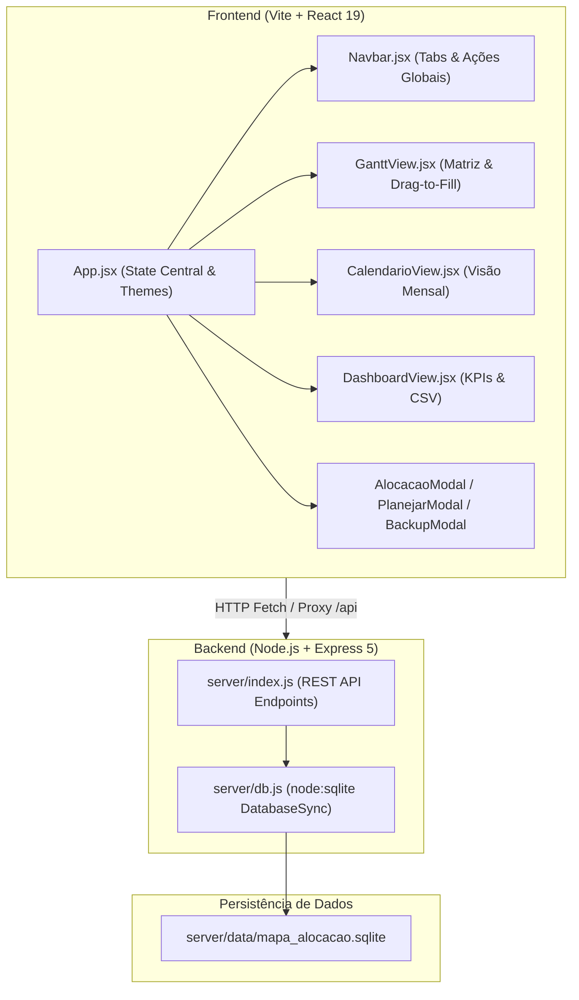
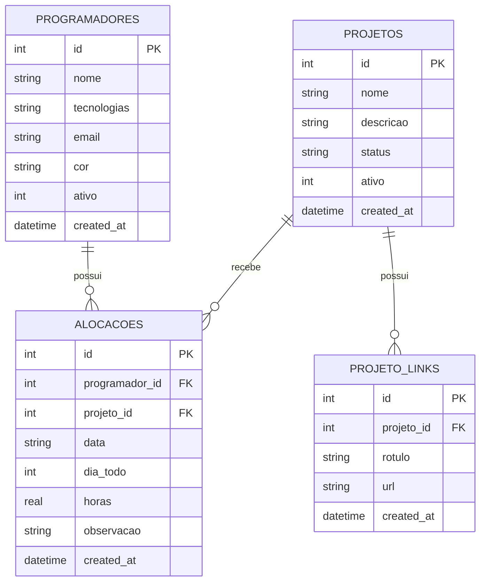

# 🛠️ Arquitetura & Especificação Técnica

Este documento descreve as decisões de arquitetura, a pilha de tecnologia, o modelo de dados relacional e a convenção de APIs do sistema **Controle Mapa de Alocação**.

---

## 🏛️ Visão Geral da Arquitetura

---

## 💻 Pilha de Tecnologias (Tech Stack)

### 1. Frontend
- **React 19.3**: Utilizando functional components, hooks modernos (`useState`, `useEffect`, `useCallback`, `useMemo`, `useRef`).
- **Vite 8.3**: Ferramenta de build ultrarrápida com Hot Module Replacement (HMR) e servidor de desenvolvimento com proxy configurado para `/api` -> `http://localhost:3001`.
- **CSS Vanilla Modular**: Design System próprio construído com CSS Custom Properties (variáveis CSS), glassmorphism, suporte nativo a `[data-theme="dark"]` e `[data-theme="light"]`. Sem dependência de frameworks CSS pesados (Zero Tailwind).

### 2. Backend
- **Node.js 22+ & Express 5.3**: Servidor HTTP moderno com suporte a ES Modules nativos (`"type": "module"`).
- **SQLite Nativo (`node:sqlite`)**:
  - Utiliza `DatabaseSync` nativo do Node.js, dispensando compilação de binários de C++ ou bibliotecas nativas de terceiros como `node-gyp`.
  - Ativação de `PRAGMA foreign_keys = ON;` para garantir exclusões em cascata seguras.
- **Transações Atômicas**: Operações em lote (como preenchimento por período e restauração de backup) utilizam `BEGIN TRANSACTION ... COMMIT / ROLLBACK`.

---

## 🗄️ Esquema do Banco de Dados (Database Schema)

---

## 🌐 Catálogo de Endpoints da API REST

### Programadores
- `GET /api/programadores`: Lista todos os programadores ativos.
- `GET /api/cores-disponiveis`: Retorna a paleta padrão de 12 cores, as cores em uso e a próxima cor livre sugerida.
- `POST /api/programadores`: Cria um programador (Nome é obrigatório pela [[02 - Regras de Negocio (RNs)#RN-02: Campo Obrigatório de Programador|RN-02]]).
- `PUT /api/programadores/:id`: Atualiza dados do programador.
- `DELETE /api/programadores/:id`: Remove o programador e suas alocações em cascata.

### Projetos & Links
- `GET /api/projetos`: Lista projetos ativos com seus links aninhados.
- `POST /api/projetos`: Cria projeto e seus links.
- `PUT /api/projetos/:id`: Atualiza dados e sincroniza links do projeto.
- `DELETE /api/projetos/:id`: Remove projeto e alocações em cascata.
- `POST /api/projetos/:id/links`: Adiciona link individual a um projeto.
- `DELETE /api/projetos/links/:linkId`: Remove link individual.

### Alocações
- `GET /api/alocacoes`: Lista alocações (com filtros opcionais `?data_inicio=...&data_fim=...`).
- `POST /api/alocacoes`: Cria alocação pontual (padrão 8.0 horas).
- `PUT /api/alocacoes/:id`: Atualiza dados, data ou reatribui desenvolvedor e projeto.
- `DELETE /api/alocacoes/:id`: Remove alocação.
- `POST /api/alocacoes/periodo`: Cria alocações em lote por intervalo de datas (apenas dias úteis).
- `POST /api/alocacoes/lote`: Replicador contínuo em lote (usado pela alça de preenchimento).

### Backup & Governança
- `GET /api/backup/export`: Exporta payload JSON completo com metadados e tabelas.
- `POST /api/backup/import`: Restaura e sincroniza banco de dados a partir de arquivo JSON validado.
